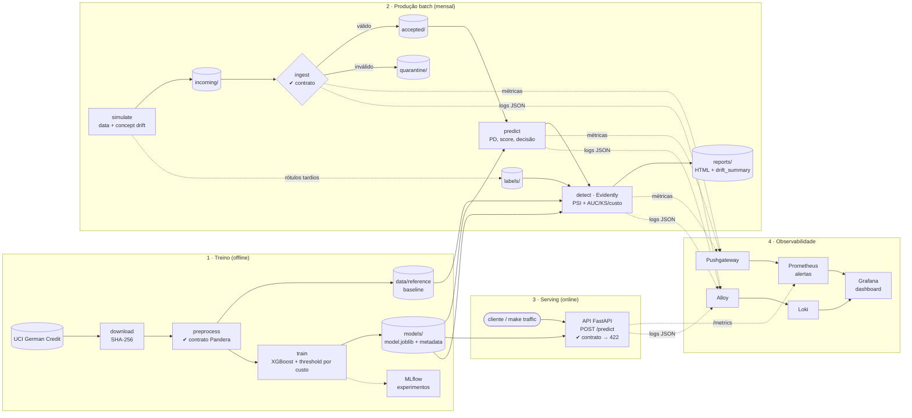

# credit-scoring-model-observability-drift

Quarto tech challenge da pós-tech FIAP em Machine Learning Engineering. O projeto constrói um modelo de classificação de risco de crédito e cuida de tudo o que vem depois do treino: contratos de qualidade de dados, simulação de degradação em produção (Data Drift e Concept Drift), detecção de drift, observabilidade de pipeline e modelo, e governança sob a LGPD.

## Contexto

Uma fintech usa um modelo para decidir se aprova ou recusa pedidos de crédito. O modelo foi
treinado com dados de um período estável. Ao longo de 2025 o cenário muda: a **inflação** eleva
valores e prazos dos empréstimos, a empresa capta um **novo perfil de cliente** e, depois, perfis
antes considerados seguros (clientes sem conta corrente e clientes com crédito em outras
instituições) passam a **inadimplir mais**. O modelo continua respondendo, mas as decisões pioram
em silêncio.

O objetivo é mostrar como um time de ML percebe e reage a isso:

| Pergunta | Como o projeto responde |
| --- | --- |
| O dado que chega é válido? | Contrato de dados (Pandera) na ingestão e na API. Lote inválido vai para quarentena; requisição inválida recebe 422 |
| O modelo é bom e decide pelo custo certo? | XGBoost com threshold que minimiza o custo esperado (aprovar um mau pagador custa 5x mais que recusar um bom) |
| A população mudou? (Data Drift) | PSI por feature e da PD prevista, mês a mês, com Evidently |
| O modelo ainda acerta? (Concept Drift) | AUC, KS e custo esperado com rótulos tardios, mês a mês |
| Alguém fica sabendo? | Logs JSON (Loki), métricas (Prometheus/Pushgateway), dashboard (Grafana) e alertas |
| O tratamento de dados é lícito e justo? | Base legal, minimização, retenção e auditoria de viés ([LGPD](#proteção-de-dados-e-governança-lgpd)) |

### Resultados

**Modelo** (XGBoost, threshold de PD = 0,11, versão atual em `models/metadata.json`):

| Conjunto | AUC | KS | Recall (maus) | Aprovação | Custo esperado |
| --- | --- | --- | --- | --- | --- |
| Validação cruzada (out-of-fold) | 0,80 | 0,47 | 91% | 37% | 0,49 |
| Teste (holdout, n = 200) | 0,80 | 0,55 | 88% | 34% | 0,57 |

O threshold baixo é intencional: com custo 5:1, o modelo prefere recusar na dúvida, e a aprovação
fica perto de 35%.

**Produção simulada** (`make detect`, 12 lotes de ~300 solicitações):

| Período | O que muda | Default real | AUC | Aprovação | Status |
| --- | --- | --- | --- | --- | --- |
| jan–mar | nada (mesma distribuição do treino) | 31–34% | 0,78–0,82 | 32% | `ok` |
| abr–jul | data drift: inflação, prazos maiores, novo perfil de cliente | 31–39% | 0,76–0,83 | 25–32% | `data_drift` em jun e jul |
| ago–dez | + concept drift: perfis "seguros" passam a inadimplir | 38–52% | 0,80 → **0,68** | 25% → 17% | `degraded` em nov e dez |

O data drift sozinho quase não afeta a AUC: o modelo continua ordenando bem os clientes. O concept
drift é o que derruba o desempenho abaixo do mínimo de 0,70 e dispara o alerta
`ModelPerformanceDegraded`. O gabarito do que foi alterado em cada lote fica em
`data/production/simulation_manifest.json`.

### Arquitetura



| Bloco | O que faz | Onde |
| --- | --- | --- |
| 1 · Treino | Baixa e valida os dados, gera o baseline de drift e treina o modelo com threshold que minimiza o custo 5:1 | `src/credit_scoring/data`, `model` |
| 2 · Produção batch | Valida cada lote no contrato, gera decisões e, com os rótulos tardios, mede data drift (PSI) e concept drift (AUC, KS, custo) | `data/ingest.py`, `model/predict.py`, `drift/` |
| 3 · Serving | Score em tempo real com o mesmo modelo e o mesmo contrato de dados | `serving/app.py` |
| 4 · Observabilidade | Métricas e logs de todas as etapas convergem no Grafana; o Prometheus avalia os alertas | `observability/`, `monitoring/` |

Detalhes de métricas, logs, alertas e resposta a incidentes estão no
[runbook de observabilidade](docs/runbooks/observability.md). As regras do contrato de dados estão
em [data_contract.md](docs/governance/data_contract.md).

### Stack

Python 3.12 · uv · pandas · scikit-learn · XGBoost · Pandera · Evidently · MLflow · FastAPI ·
Prometheus · Pushgateway · Grafana Loki · Grafana Alloy · Grafana · Docker Compose

## Dataset

[Statlog German Credit Data](https://archive.ics.uci.edu/dataset/144/statlog+german+credit+data) (UCI, licença CC BY 4.0):
1.000 solicitantes de crédito, 20 atributos (7 numéricos, 13 categóricos) e alvo binário
(700 bons / 300 maus pagadores). O dado bruto não é versionado; baixe com `make data`
(integridade validada por SHA-256). A carga decodificada fica em
`credit_scoring.data.load.load_german_credit()`, com o alvo `default` (1 = mau pagador).

> O dataset original define custo assimétrico: classificar um mau pagador como bom custa 5x mais
> que o erro inverso. Atributos sensíveis (`sex`, `marital_status`, `foreign_worker`, `age`) são
> usados apenas para auditoria de viés, não como features. Ver [Proteção de dados](#proteção-de-dados-e-governança-lgpd).

## Como rodar localmente

### Pré-requisitos

- [uv](https://docs.astral.sh/uv/) (instala o Python 3.12 e as dependências do `uv.lock`)
- Docker com Docker Compose (só para a stack de observabilidade)
- `make`
- Portas livres: 3000, 3100, 5000, 8000, 9090, 9091, 12345

### Caminho rápido

```bash
make install         # cria .venv e instala dependências
make observability   # sobe a stack, roda o pipeline completo e gera tráfego na API
```

Depois abra:

| Serviço | URL |
| --- | --- |
| Dashboard Grafana | http://localhost:3000 (acesso anônimo, abre no dashboard do projeto) |
| Alertas | http://localhost:9090/alerts |
| API (Swagger) | http://localhost:8000/docs |
| MLflow | http://localhost:5000 |
| Relatórios Evidently | `reports/evidently/*.html` |

> A API carrega `models/model.joblib` na subida. Na primeira execução o modelo ainda não existe
> quando `make up` roda, então rode `docker compose restart api` depois do `make pipeline` (ou
> rode `make install pipeline` antes do `make observability`). O mesmo vale depois de um `make train`.

### Passo a passo

Sem Docker, dá para rodar cada etapa isoladamente. As métricas para o Pushgateway são opcionais:
se ele estiver fora do ar, a etapa registra `metrics_push_failed` e segue.

```bash
make install        # uv sync - cria .venv e instala dependências do uv.lock
make data           # baixa o German Credit (UCI) para data/raw
make preprocess     # trata, valida contra o contrato de dados e gera train/test e reference
make demo-contract  # demonstra o contrato bloqueando um lote com erros
make ingest FILE=…  # ingere um lote: aceito ou quarentena (exit 1)
make train          # treina o XGBoost (busca de hiperparâmetros + threshold por custo) e salva em models/
make mlflow-ui      # abre o MLflow em http://localhost:5000 para comparar execuções
make simulate       # gera 12 lotes mensais de produção (jan-dez/2025) com data drift (abr+) e concept drift (ago+)
make predict        # gera PD, score (0-1000) e decisão para cada lote de produção
make detect         # Evidently: referência x produção por mês (drift PSI + desempenho) -> reports/
make pipeline       # roda todas as etapas instrumentadas (logs + métricas) com o mesmo RUN_ID
make serve          # API local com reload: POST /predict, GET /health, GET /metrics
make up / down      # sobe/derruba api, prometheus, pushgateway, loki, alloy, grafana e mlflow
make traffic        # gera tráfego na API a partir dos lotes de produção
make logs           # acompanha logs/pipeline.jsonl
make test           # pytest com cobertura
make lint           # ruff
```

`make pipeline` só treina se ainda não existir `models/model.joblib`; retreinar é uma decisão
explícita (`make train`). Os parâmetros da simulação, do modelo e dos limiares de drift ficam em
[configs/config.yaml](configs/config.yaml).

### Testando a API

```bash
curl -s http://localhost:8000/health

curl -s -X POST http://localhost:8000/predict -H 'Content-Type: application/json' -d '[{
  "application_id": "APP-90000001", "duration_months": 24, "credit_amount": 3500,
  "installment_rate": 3, "residence_since": 2, "existing_credits": 1, "num_dependents": 1,
  "checking_status": "no checking account", "credit_history": "existing credits paid duly",
  "purpose": "car (used)", "savings_status": "< 100 DM", "employment_since": "1 <= ... < 4 years",
  "other_debtors": "none", "property": "car or other", "other_installment_plans": "none",
  "housing": "own", "job": "skilled employee / official", "own_telephone": "yes",
  "foreign_worker": "no", "age": 35, "sex": "female", "marital_status": "single"
}]'
```

A resposta traz `default_proba`, `score` (0–1000, maior = menor risco), `decision`
(`approve`/`reject`) e `model_version`. Um valor fora do domínio (ex.: `"purpose": "crypto"`)
retorna **422** com as violações do contrato e incrementa `api_contract_violations_total`.

## Como rodar em produção

> **Escopo.** O projeto roda hoje em Docker Compose numa única máquina. Esta seção descreve como
> levá-lo para um ambiente produtivo e o que muda em relação ao ambiente local. Itens ✅ já estão
> prontos no código; 📋 são necessários antes de expor o serviço com dados reais.

### Componentes

| Componente | Em produção | Configuração |
| --- | --- | --- |
| API de scoring | Imagem do [Dockerfile](Dockerfile) (`uvicorn` na porta 8000), atrás de um load balancer, com healthcheck em `GET /health` | `MODELS_DIR`, `LOG_DIR` |
| Artefato do modelo | `model.joblib` + `metadata.json` montados em `MODELS_DIR` (volume, bucket sincronizado ou imagem versionada por modelo) | gerados por `make train` |
| Etapas batch (ingest, predict, detect) | Jobs agendados (cron, Airflow, Kubernetes CronJob) usando a mesma imagem: `python -m credit_scoring.<módulo>` | `RUN_ID`, `PUSHGATEWAY_URL`, `LOG_DIR` |
| Prometheus + Pushgateway | Coletam a API e as etapas batch; avaliam [alerts.yml](monitoring/prometheus/alerts.yml) | [monitoring/prometheus/](monitoring/prometheus/) |
| Loki + Alloy | Alloy lê `LOG_DIR/*.jsonl` de cada host e envia ao Loki | [config.alloy](monitoring/alloy/config.alloy) |
| Grafana | Datasources e dashboard provisionados como código | [monitoring/grafana/](monitoring/grafana/) |
| MLflow | Servidor com backend em banco (PostgreSQL) e artefatos em object storage | `mlflow.tracking_uri` |

Variáveis de ambiente:

| Variável | Padrão | Uso |
| --- | --- | --- |
| `MODELS_DIR` | `models` | Diretório com `model.joblib` e `metadata.json` carregados na subida da API |
| `LOG_DIR` | `logs` | Onde os logs JSON (`pipeline.jsonl`, `api.jsonl`) são gravados para o Alloy |
| `PUSHGATEWAY_URL` | `localhost:9091` | Destino das métricas das etapas batch |
| `RUN_ID` | gerado | Correlaciona logs e métricas de uma mesma execução do pipeline |

### Deploy da API

```bash
# 1. treinar e validar o modelo (fora do caminho crítico)
make train && make test

# 2. construir e publicar a imagem
docker build -t <registry>/credit-scoring-api:<versão> .
docker push <registry>/credit-scoring-api:<versão>

# 3. rodar com o modelo montado (somente leitura) e logs num volume coletado pelo Alloy
docker run -d -p 8000:8000 \
  -e MODELS_DIR=/app/models -e LOG_DIR=/app/logs \
  -v /srv/credit-scoring/models:/app/models:ro \
  -v /srv/credit-scoring/logs:/app/logs \
  <registry>/credit-scoring-api:<versão>

# 4. conferir a versão carregada
curl -s http://<host>:8000/health
```

A API carrega o modelo uma vez, na subida. **Trocar de modelo = reiniciar a API** com o novo
artefato em `MODELS_DIR`; a métrica `model_info{version, threshold}` confirma a troca no Grafana.

### Ciclo de operação

1. **Diariamente / a cada lote:** `ingest` valida o lote no contrato (inválido vai para quarentena e
   dispara `IngestionBatchRejected`) e `predict` grava as decisões com versão e threshold.
2. **Mensalmente, com rótulos tardios:** `detect` calcula PSI e desempenho por lote. O alerta
   `DriftDetectionStale` dispara se essa etapa ficar mais de 35 dias sem sucesso.
3. **Quando um alerta de drift ou desempenho disparar:** seguir o
   [runbook](docs/runbooks/observability.md#alertas-e-resposta). Retreino com dados recentes passa
   por `make train`, comparação no MLflow e aprovação antes de substituir o artefato.

## Proteção de dados e governança (LGPD)

> **Escopo.** O German Credit é um dataset público e anonimizado (Alemanha, 1994), sem titulares
> identificáveis. Este plano descreve como o sistema trata os dados **como se operasse com clientes
> reais no Brasil**. Cada medida indica se está ✅ implementada ou 📋 apenas planejada.

### 1. Base legal

| Tratamento | Base legal (LGPD) |
| --- | --- |
| Análise de risco e decisão de crédito | **Art. 7º, X: proteção do crédito.** Não depende de consentimento; o tratamento se limita à finalidade de avaliar o risco de concessão |
| Monitoramento do modelo (drift, desempenho) | Art. 7º, IX: legítimo interesse, para garantir que as decisões continuem corretas. É compatível com a finalidade original (art. 6º, I) |
| Auditoria de viés com atributos protegidos | Art. 6º, IX: princípio da não discriminação. Os atributos servem **só** para medir viés, nunca para decidir |

**Decisão automatizada (art. 20).** O titular pode pedir a revisão de uma decisão automatizada e
informações sobre os critérios usados. ✅ Toda predição guarda o `application_id`, a versão do modelo,
o threshold e o horário (`data/production/predictions/`). Isso permite reconstruir e reavaliar qualquer
decisão. 📋 Falta um canal de revisão com análise humana e uma explicação individual por decisão (ex.: SHAP).

> Sexo, idade, estado civil e nacionalidade **não** são "dados sensíveis" no sentido estrito do
> art. 5º, II, mas são atributos de **potencial discriminatório** e recebem tratamento equivalente.

### 2. Tratamento de dados pessoais (PII)

| Medida | Como foi feito | |
| --- | --- | --- |
| **Minimização** (art. 6º, III) | Nenhum identificador direto (nome, CPF, endereço). O contrato de dados é estrito e **rejeita colunas não previstas**: um lote com `cpf` é bloqueado | ✅ |
| **Pseudonimização** | `application_id` (`APP-00001`) é sequencial e não deriva de dado pessoal. Ele liga predição, rótulo e lote sem expor o titular | ✅ |
| **Separação de atributos protegidos** | `sex`, `marital_status`, `foreign_worker` e `age` ficam em `SENSITIVE_COLUMNS` e são excluídos das features do modelo | ✅ |
| **Saídas sem PII** | O log de predições, a resposta da API, os logs (Loki) e as métricas (Prometheus) contêm apenas ID, resultado do modelo e agregados | ✅ |
| **Dados fora do Git** | `data/`, `models/`, `reports/` e `logs/` estão no `.gitignore` | ✅ |
| **Qualidade** (art. 6º, V) | Contrato de dados com Pandera: lotes inválidos vão para quarentena e não chegam ao modelo | ✅ |
| **Segurança** (art. 46) | Criptografia em repouso, controle de acesso aos buckets e à API, autenticação no Grafana | 📋 |
| **RIPD** (art. 38) | Relatório de Impacto à Proteção de Dados formal | 📋 |

### 3. Plano de retenção

| Dado | Prazo | Justificativa | Descarte |
| --- | --- | --- | --- |
| Solicitações e rótulos de produção (`data/production/`) | 5 anos após o fim da relação | Prazo prescricional de dívidas (CC art. 206, §5º, I) e limite para informação negativa (CDC art. 43, §1º) | Exclusão ou anonimização |
| Log de predições (auditoria de decisões) | 5 anos | Atender pedidos de revisão (art. 20) e auditorias | Exclusão |
| Lotes em quarentena | 90 dias | Tempo para investigar e corrigir a origem | Exclusão |
| Dataset de referência e modelo | Enquanto o modelo estiver em produção + 5 anos | Reproduzir decisões tomadas com aquela versão | Exclusão |
| Logs operacionais (Loki) | 6 meses | Diagnóstico de incidentes; referência no Marco Civil (art. 15) | Expiração automática |
| Métricas agregadas (Prometheus) | 1 ano | Sem dado pessoal; análise de tendência de drift | Expiração automática |

📋 Os prazos ainda não são aplicados automaticamente. A implementação prevista é um job agendado de
expurgo, mais `retention_period` no Loki e `--storage.tsdb.retention.time` no Prometheus. Pedidos de
eliminação do titular (art. 18, VI) devem respeitar esses prazos de guarda legal.

### 4. Vieses: avaliação e mitigação

Excluir os atributos protegidos **não garante** um modelo justo: outras variáveis podem funcionar
como *proxy* deles. Por isso medimos a taxa de aprovação por grupo no holdout de teste (n = 200),
usando a **razão de impacto desigual** (aprovação do grupo menos favorecido ÷ do mais favorecido).
Pela regra dos 4/5, valores abaixo de **0,8** indicam possível discriminação.

| Grupo | Aprovação | Aprovação entre bons pagadores | Default real | Razão de impacto |
| --- | --- | --- | --- | --- |
| Masculino / Feminino | 34,5% / 32,8% | 44% / 42% | 29% / 33% | **0,95** ✅ |
| ≥ 25 anos / < 25 anos | 36,6% / 23,1% | 45% / 35% | 26% / 49% | **0,63** ⚠️ |
| Estrangeiro: não / sim | 50,0% / 33,5% | — | — | 0,67 (n = 6, inconclusivo) |

**Leitura.** Não há disparidade relevante por sexo. Clientes **com menos de 25 anos** são aprovados
bem menos, embora `age` não seja feature. Parte da diferença reflete um risco real maior (default de
49% contra 26%), mas, entre os **bons pagadores**, os jovens também são menos aprovados (35% contra
45%). Isso é um sinal de **viés por proxy**, provavelmente via `employment_since`, `housing` e
`duration_months`.

**Mitigação:**

1. ✅ Atributos protegidos fora das features; ✅ medição de viés documentada.
2. 📋 Monitorar a razão de impacto por grupo a cada lote, como métrica no Prometheus com alerta abaixo de 0,8, no mesmo fluxo do drift.
3. 📋 Revisão humana obrigatória para recusas de clientes < 25 anos próximas do threshold.
4. 📋 No próximo retreino, testar a remoção ou o agrupamento dos proxies e restrições de fairness (ex.: `fairlearn`), medindo o custo em AUC.
5. 📋 Registrar a decisão final (aceitar, mitigar ou rejeitar o modelo) no Model Card, com aprovação de risco e jurídico.

## Estrutura do projeto

```
├── configs/                # parâmetros (thresholds de drift, caminhos, seeds)
├── data/
│   ├── raw/                # dados brutos (não versionados - LGPD)
│   ├── processed/          # dados tratados
│   ├── reference/          # baseline do treino para comparação de drift
│   └── production/         # lotes simulados de produção ao longo do tempo
├── models/                 # artefatos treinados (não versionados)
├── src/credit_scoring/
│   ├── data/               # ingestão e pré-processamento
│   ├── contracts/          # contratos de qualidade de dados (Pandera) - ver docs/governance/data_contract.md
│   ├── model/              # treino, avaliação e registro (MLflow)
│   ├── drift/              # simulação e detecção de Data/Concept Drift
│   ├── causal/             # análise causal (DAG + DoWhy) - 📋 em construção
│   ├── observability/      # logs JSON (Loki) e métricas das etapas (Pushgateway)
│   └── serving/            # API FastAPI + endpoint /metrics (Prometheus)
├── monitoring/
│   ├── prometheus/         # scrape config e regras de alerta
│   ├── alloy/              # coleta de logs/*.jsonl -> Loki
│   └── grafana/            # datasources (Prometheus + Loki) e dashboard provisionado
├── docs/
│   ├── governance/         # LGPD, RIPD, base legal, retenção
│   ├── model_card/         # Model Card e Data Card
│   └── runbooks/           # observabilidade e resposta a alertas (observability.md)
├── tests/unit/             # testes unitários
├── docker-compose.yml      # api, prometheus, pushgateway, loki, alloy, grafana, mlflow
├── Dockerfile
├── Makefile
└── pyproject.toml
```
