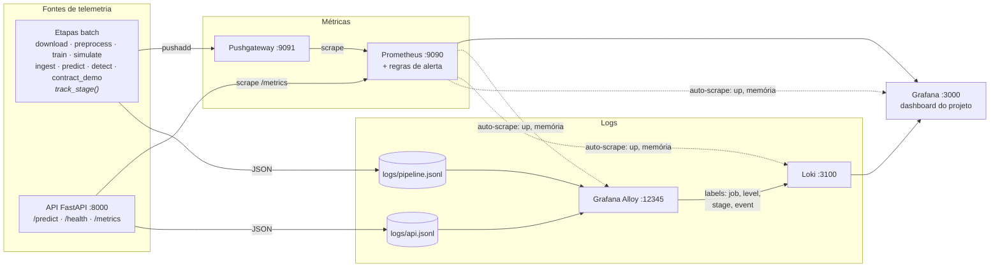

# Observabilidade de Pipelines e Modelos

Este documento descreve como o projeto dá visibilidade operacional ao pipeline de dados, à infraestrutura e ao modelo em produção, e o que fazer quando um alerta dispara.

## Arquitetura



Dois caminhos independentes chegam ao mesmo dashboard:

- **Métricas.** As etapas batch terminam antes de um scrape, então empurram (`pushadd`) para o Pushgateway; a API expõe `/metrics` e é coletada direto. O Prometheus avalia os [alertas](#alertas-e-resposta) sobre essas séries.
- **Logs.** Tudo é gravado em JSON em `logs/`; o Alloy lê os arquivos, extrai os labels e envia ao Loki. O `run_id` correlaciona logs e métricas de uma mesma execução.

| Componente | Papel | Código / configuração |
|---|---|---|
| `track_stage()` | Instrumenta cada etapa: logs de início, fim e falha (com stack trace) e métricas de status e duração | `src/credit_scoring/observability/metrics.py` |
| `setup_logging()` | Logs JSON com `run_id`, `stage`, `event` e campos extras | `src/credit_scoring/observability/logs.py` |
| Pushgateway | Recebe as métricas das etapas batch, que terminam antes de um scrape | `docker-compose.yml` |
| Grafana Alloy | Coleta `logs/*.jsonl` e envia ao Loki com os labels `job`, `level`, `stage` e `event` | `monitoring/alloy/config.alloy` |
| Prometheus | Coleta a API, o Pushgateway e a própria stack, e avalia os alertas | `monitoring/prometheus/` |
| Grafana | Dashboard provisionado com métricas e logs | `monitoring/grafana/` |

## Como rodar

```bash
make up              # sobe a stack (api, prometheus, pushgateway, loki, alloy, grafana, mlflow)
make pipeline        # roda todas as etapas com o mesmo RUN_ID
make traffic         # envia os lotes de produção para a API, com algumas requisições inválidas
# ou tudo de uma vez:
make observability
```

| Serviço | URL |
|---|---|
| Dashboard | http://localhost:3000 (abre direto no dashboard do projeto) |
| Alertas | http://localhost:9090/alerts |
| Pushgateway | http://localhost:9091 |
| API (docs) | http://localhost:8000/docs |

A API carrega o modelo na subida. Depois de um `make train`, rode `docker compose restart api`.

## Logs

Cada linha de `logs/pipeline.jsonl` e `logs/api.jsonl` é um JSON:

```json
{"timestamp": "2026-11-11T00:33:28.223+00:00", "level": "ERROR", "logger": "credit_scoring.data.ingest",
 "message": "Lote batch_corrupted.parquet BLOQUEADO: 14 violações ...", "run_id": "20261110-213318",
 "stage": "contract_demo", "event": "batch_rejected", "batch": "batch_corrupted", "rows": 51,
 "violations": 14, "violated_rules": ["column_in_schema", "greater_than(0)", "..."]}
```

| `event` | Quando |
|---|---|
| `stage_started` / `stage_finished` | início e fim de cada etapa (`status`, `duration_s`) |
| `stage_failed` | exceção na etapa (`error_type`, `exception` com stack trace) |
| `batch_accepted` / `batch_rejected` | resultado do contrato de dados na ingestão |
| `drift_evaluated` | resultado mensal do Evidently (`status`, `roc_auc`, `drifted_features`) |
| `metrics_push_failed` | Pushgateway indisponível; o pipeline continua |
| `model_loaded`, `predictions_served`, `api_contract_violation` | eventos da API |

Consultas úteis no Loki (Grafana → Explore):

```logql
{job="credit-scoring-pipeline", level="ERROR"}                         # erros do pipeline
{job="credit-scoring-pipeline", event="stage_failed"} | json            # falhas com stack trace
{job="credit-scoring-pipeline"} | json | run_id="20261110-213318"       # uma execução inteira
{job="credit-scoring-pipeline", event="drift_evaluated"} | json | status="degraded"
```

## Métricas

### Pipeline (Pushgateway, `job="credit_scoring_pipeline"`)

| Métrica | Labels | Descrição |
|---|---|---|
| `pipeline_stage_success` | `stage` | 1 = sucesso, 0 = falha na última execução |
| `pipeline_stage_duration_seconds` | `stage` | duração da última execução |
| `pipeline_stage_last_run_timestamp_seconds` | `stage` | horário da última execução |
| `pipeline_stage_last_success_timestamp_seconds` | `stage` | horário do último sucesso |
| `ingestion_batch_accepted` | `batch` | 1 = aceito, 0 = bloqueado pelo contrato |
| `ingestion_batch_rows`, `ingestion_batch_violations` | `batch` | linhas e violações por lote |
| `ingestion_contract_violations` | `batch`, `column`, `check` | violações por regra |
| `dataset_rows`, `dataset_default_rate` | `split` | dados de treino e teste (`preprocess`) |
| `model_training_*`, `model_threshold` | `split` | métricas do treino (`train`) |
| `prediction_batch_*` | `batch` | aprovação, score médio e volume por lote (`predict`) |

### Drift e modelo (etapa `detect`, Evidently)

| Métrica | Labels | Uso |
|---|---|---|
| `drift_feature_psi` | `feature`, `month` | histórico: matriz de PSI no dashboard |
| `drift_drifted_columns`, `model_health_status_code` | `month` | histórico |
| `model_roc_auc`, `model_ks`, `model_recall`, `model_precision`, `model_approval_rate`, `model_expected_cost`, `production_default_rate`, `model_mean_default_proba` | `month` | histórico de desempenho |
| `feature_psi` | `feature` | **último mês**, usado nos alertas |
| `prediction_psi`, `model_auc`, `drifted_columns`, `model_health_status` | — | **último mês**, usado nos alertas |

### API (scrape em `/metrics/`)

| Métrica | Tipo | Descrição |
|---|---|---|
| `api_requests_total{endpoint, status_code}` | counter | requisições |
| `api_request_latency_seconds{endpoint}` | histogram | latência |
| `model_predictions_total{decision}` | counter | aprovações e recusas |
| `model_score`, `model_default_proba` | histogram | distribuição da saída do modelo |
| `api_contract_violations_total{check}` | counter | requisições barradas (HTTP 422) |
| `model_info{version, threshold}` | gauge | versão do modelo carregado |

### Infraestrutura

`up{job}` para todos os serviços, além das métricas nativas de Prometheus, Loki, Alloy e Grafana, como memória (`process_resident_memory_bytes`) e linhas de log recebidas (`loki_distributor_lines_received_total`).

## Alertas e resposta

| Alerta | Severidade | O que fazer |
|---|---|---|
| `PipelineStageFailed` | critical | No painel "Erros e alertas", ou em `{event="stage_failed", stage="<etapa>"}`, leia o `error_type` e o stack trace. Corrija a causa e rode a etapa de novo; o alerta se resolve no próximo sucesso. |
| `IngestionBatchRejected` | warning | Abra `data/production/quarantine/<lote>.violations.csv`. Erro na origem: corrigir e reenviar o lote. Mudança legítima no domínio (ex.: nova categoria): atualizar o contrato (`contracts/schemas.py`) e versionar. |
| `DriftDetectionStale` | warning | A detecção de drift não roda com sucesso há mais de 35 dias. Verifique o agendamento e o histórico da etapa `detect`. |
| `FeatureDriftCritical` / `PredictionDriftCritical` | warning | Data drift. Abra o relatório `reports/evidently/data_drift_<mês>.html` e confira se o desempenho, que depende dos rótulos, também caiu. Sem queda de AUC: monitorar. |
| `ModelPerformanceDegraded` | critical | AUC < 0,70, possível concept drift. Comparar `production_default_rate` com `model_mean_default_proba`: se o default real supera a PD prevista, o modelo subestima o risco. Ações: ajustar o threshold no curto prazo, retreinar com dados recentes e conduzir a análise causal antes de recolocar o modelo. |
| `ApiDown` / `ObservabilityTargetDown` | critical / warning | `docker compose ps` e `docker compose logs <serviço>`. |
| `ApiHighLatency` | warning | Ver o painel de latência; checar o tamanho dos lotes enviados e os recursos do container. |
| `ApiContractViolations` | warning | Requisições inválidas chegando à API. Identificar a regra violada no label `check` e o cliente de origem. |

## Decisões de desenho

- **A observabilidade nunca derruba o pipeline.** Se o Pushgateway estiver fora do ar, o envio falha com um aviso em log (`metrics_push_failed`) e a etapa segue normalmente.
- **`pushadd` em vez de `push`.** Quando uma etapa falha, só as métricas de status são atualizadas. As métricas de negócio da última execução bem-sucedida continuam visíveis.
- **Histórico × atual.** Os meses simulados chegam ao Prometheus todos ao mesmo tempo, com o label `month`. Os painéis de evolução usam esse label, e os alertas usam as séries sem `month`, que refletem o mês mais recente.
- **Lote bloqueado não é falha do pipeline.** `pipeline_stage_success=1` com `ingestion_batch_accepted=0` significa que o pipeline funcionou e o contrato barrou dados ruins. São alertas diferentes.
- **LGPD.** Os logs e as métricas não contêm dados pessoais, apenas IDs pseudonimizados, contagens e agregados.
